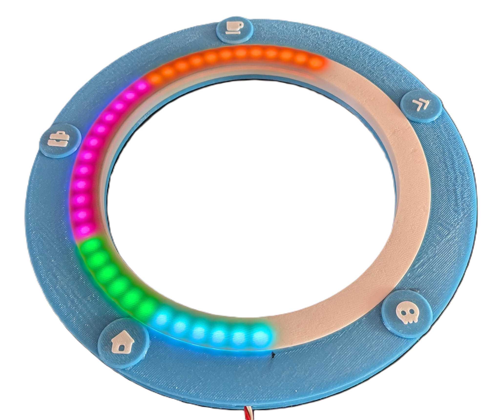
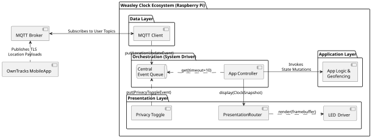
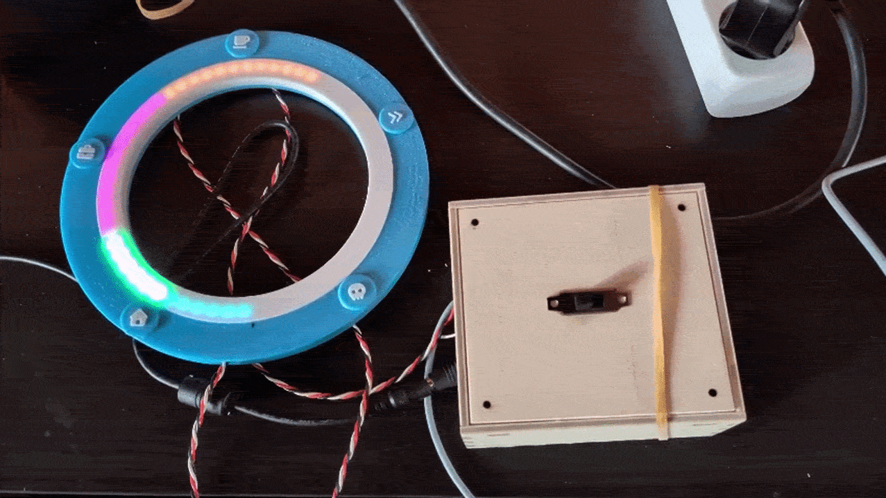

# The Modern Weasley Clock: An Ambient Location Awareness System Powered by MQTT and RGB LED Visualizations

 [](https://opensource.org/licenses/MIT) [](http://unmaintained.tech/)    

The Weasley Clock is a clock that keeps track of people's locations instead of time.
This project provides an IoT version of this, using MQTT and an RGB LED ring.



## Structure

The following component diagram shows how the different parts of the system fit together:



- [The AppController/Event Queue](src/weasley_clock/orchestration/README.md): Orchestrates the application; acts as a consumer, ingesting events from the message queue, having the Application Logic act upon them and having the Presentation Layer update the user interface.
- [The Data Layer](src/weasley_clock/data_layer/README.md): is responsible for connecting to the MQTT broker and delivering `LocationUpdateEvent`s to the central event queue.
- [The Application Layer](src/weasley_clock/app_layer/README.md): Contains the business logic. It keeps track of the application state and performs the geofencing logic to convert location updates to semantic locations.
- [The Presentation Layer](src/weasley_clock/presentation_layer/README.md): Drives the hardware (LED ring and Privacy Switch) or, if running on a Non-Raspberry-Pi platform, mock versions that read from the keyboard/print to the console.
It converts the system state to a framebuffer which is then pushed to the LED ring by the `LEDDriver`.

## Dependencies

This project depends on the following core software components/libraries.
All python dependencies are listed in the [pyproject.toml file](pyproject.toml).

- [uv](https://docs.astral.sh/uv/): - is the package/project manager I used as an alternative to `pip`
- [OwnTracks Mobile App](https://owntracks.org/) - runs on the users' smartphones and regularly publishes MQTT location updates
- [HiveMQ Cloud MQTT Broker](https://www.hivemq.com/) - is the concrete MQTT broker I chose to test the prototype
- [paho-mqtt](https://pypi.org/project/paho-mqtt/) - the python library for interacting with the MQTT broker
- [gpiozero](https://gpiozero.readthedocs.io/en/stable/) - the python library for listening to GPIO events (used for the Privacy Switch)
- [rpi-ws28x](https://github.com/jgarff/rpi_ws281x) - the python library for controlling the NeoPixel ring

## Installation

### Installation on a development machine

This project uses `uv` as its package manager which needs to be installed before importing the project.
Installation instructions can be [found on their website](https://docs.astral.sh/uv/getting-started/installation/).

To setup the project, either use an IDE that supports uv projects natively (such as [PyCharm](https://www.jetbrains.com/de-de/pycharm/)) or use

```bash
uv sync
```

from the project root (the directory where the `pyproject.toml` file is located).

This will create a separate virtual environment for the project and install all dependencies.

In addition, the files `config.json` and `.env` must be present in the project root.

### Setting up `config.json`

The Weasley Clock uses two configuration files, `config.json` and `.env`.
This section focuses on the `config.json` file which contains the geofences, colour-to-user mappings and other application settings which are optional.
In the application root, you find [an example of a valid configuration file](example_config.json).

The `users` property must contain exactly four `user` objects, each following the structure

``` json
"Person1": {
      "tid": "p1",
      "color_rgb": [
        255,
        100,
        0
      ],
      "geofences": {
        "HOME": [
          {
            "lat": 48.208200,
            "lon": 16.3738,
            "radius_m": 50
          }
        ],
        "WORK_UNI": [
          {
            "lat": 48.209100,
            "lon": 16.3738,
            "radius_m": 50
          }
        ]
      }
    }
```

You can choose the name of the user (here `Person1`) freely.
It is primarily used to distinguish different household members during setup.
The name needs to be unique.

The `tid` (Tracker Id) property needs to be one of `p1`, `p2`, `p3` or `p4`.
Those are the same TIDs [used by the OwnTracks App](setup/owntracks/README.md).
This field is used to map a MQTT client to a household member.

`color_rgb` assigns an RGB color to each person.
Each value can range from 0 to 255.
I recommend choosing high-contrast colours that are easy to differentiate.

The `HOME` and `WORK_UNI` properties setup the geofences for each semantic location.
Both require an array of geofences as their value.
This array must contain at least one geofence.
It can contain more than one geofence because it might be the case that, for example, a university is scattered across multiple buildings, and therefore a user should be considered as at `WORK_UNI` if they are in _any_ of the provided geofences.

The geofences themselves are circles.
They consist of latitude, longitude (the middle point of the geofence) and radius in meters.
I recommend [using an online tool](https://www.mapdevelopers.com/draw-circle-tool.php) to draw the geofences, then copy-paste the coordinates and radii.
While the geofences **between users** can overlap (there can be users who work at the same place, for example), the zones of any single user should not (for example, no geofence of `HOME` should overlap with one of `WORK_UNI`)

Finally, the optional `app_settings` property can change the behaviour of the Weasley Clock:

```json
"app_settings": {
    "mqtt_timeout": 600,
    "staleness_threshold": 1200,
    "battery_threshold": 15,
    "velocity_threshold": 15
  }
```

- `mqtt_timeout` sets the network timeout (how long the system waits in the case of a disconnect until it considers it to be an error and displays it)
- `staleness_threshold` sets the duration after which a users' location is considered stale after the last update (e.g., setting it to 1200 will mark a location as stale after receiving no update for 20 minutes)
- `battery_threshold` sets the threshold below which the Weasley Clock will consider a user's phone battery to be low---if the user is not at home or at work/uni _and_ their battery is low, they are marked as being in "mortal peril"
- `velocity_threshold` sets the threshold above which the Weasley Clock will consider a user to move fast enough to be in transit. A user is never in transit if they are at home or at work/uni.

### Configuring the `.env` file

This file configures the (hardware) environment of the clock and only needs to be changed if changing the MQTT broker or the hardware wiring.

It contains the following key-value pairs:

```sh
MQTT_HOST=<MQTT Host Name>
MQTT_USERNAME=<MQTT User>
MQTT_PASSWORD=<MQTT Password>
LOG_LEVEL=<Log Level, e.g. DEBUG>
LOG_TO_FILE=<TRUE | FALSE>
SWITCH_PIN=<GPIO Pin the Privacy Switch is connected to, e.g. 4>
LED_BRIGHTNESS=<LED Ring Brightness, a float from between 0 (exclusive) and 1>
LED_PIN=<GPIO Pin that connects to the LED Ring, e.g. D18>
```

While the configuration script tries to fall back to safe default values, the clock cannot function without the MQTT credentials (if not using demo mode).

### MQTT Broker Setup (HiveMQ or similar)

The process of setting up HiveMQ is explained at their website; simply generate credentials (URL, password, username) paste them into the `.env` file [and use them to setup OwnTracks.](setup/owntracks/README.md)

### Installation on the Raspberry Pi

Installation on the Raspberry Pi is similar to the development machine installation, but it requires a few extra steps which are detailed in the [/setup/raspberry pi folder](setup/raspberry%20pi/README.md).

### Hardware Setup

You can find a wiring diagram and the parts used [in the `/setup/hardware folder`](setup/hardware/README.md)
The case consists of a 3D-printed clock face and a laser-cut electronics box, see also [the `/setup/casing` folder](setup/casing/README.md).

## Usage

The system can operate in three different modes:

- **Calibration Mode**: This is useful when first setting up the LED ring and ensuring that the order of the semantic location segments lines up with what you think it is. Running `uv run calibrate_clock` will light up all segments sequentially and have you press the enter key to cycle between segments.

- **Default Mode**: Running `uv run weasley_clock` will start the application with all features enabled. This is the command you want to use if you want to use the clock.

- **Demo Mode**: This swaps out the MQTT connection with randomly generated location updates. Running `uv run weasley_clock --demo` to run the system in demo mode. In this mode, every 5-20 seconds, a new location update event is generated, and disconnects are also simulated.

## Visuals

Here you can see the Weasley Clock in action (using demo mode):



## Roadmap

Further releases could contain a Web UI for editing the geofences/colour mappings and predict user locations based on machine learning.

## Troubleshooting

### Configuration Errors

- ConfigSyntaxError: Raised when the JSON file contains invalid syntax. Please check if your configuration file contains valid JSON.
- ConfigNotFoundError:Raised when the configuration file is not found.
- ConfigSchemaError: Raised when the json violates the schema (e.g., missing keys, values out of range, etc.). Please check if the configuration file you provided matches the `example_config.json` structurally.
- DuplicateTrackerIdError: Raised when two users have the same tracker id (tid). Please ensure that the tid of every used is unique and one of `p1`, `p2`, `p3` or `p4`
- DuplicateColourError: Raised when two users have the same color (color_rgb). Please ensure that the colour assigned to each user is unique.
- GeoFenceOverlapError: Raised when geofences overlap between zones of a user. Please ensure that each geofence of `HOME` does not overlap with any of the geofences in `WORK_UNI` of any given user.

### Connection errors

The log file will contain the message `Network disconnected` with a timestamp of when the disconnect occurred if the log level is set to `WARN` or higher.
If the disconnect exceeded the timeout limit, the Weasley Clock will display the error by turning all the LEDs red.
If using a Raspberry Pi 2, unplug the WiFi dongle or the ethernet cable and plug it back in. Check your MQTT Broker's settings.

### Hardware errors

If the application is running, but the LEDs do not illuminate, check

- if the Privacy Switch is currently turned `off`
- the wiring is correct
- the power supply for the LED ring is plugged in and can provide at least 3.6 Ampere at 5 Volt

### Other errors

Any exception the system encounters will be logged.
If you have enabled logging to a file, it could provide valuable for fixing the error.

## Authors and acknowledgment

Besides myself, AI tools (mainly Google Gemini and GitHub Copilot) were also involved in the project.
They were strictly used as a means to enhance my work, acting as personal assistants.
AI usage is documented in the source code.

## Attribution

This project uses Fonts from fontawesome.com published under CC BY 4.0 for the icons of the semantic locations on the 3D-printed clock face.
The clock face is based [on a project on thingiverse.com by the user 247generator](https://www.thingiverse.com/thing:3137687), licensed under the CC BY 4.0 license, and the schematics for the electronics box were generated using [boxes.py](https://boxes.hackerspace-bamberg.de/), licensed under the GPLv3 license.

## Disclaimer

This is an unofficial, non-commercial open-source hobby and academic project inspired by Harry Potter. "Harry Potter", "Weasley", and associated names are trademarks of Warner Bros. Entertainment Inc. and J.K. Rowling. This project is not affiliated with, endorsed by, or sponsored by Warner Bros. or J.K. Rowling.
