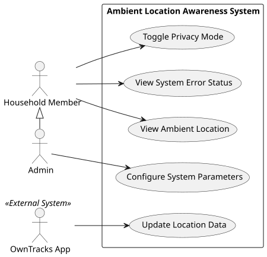
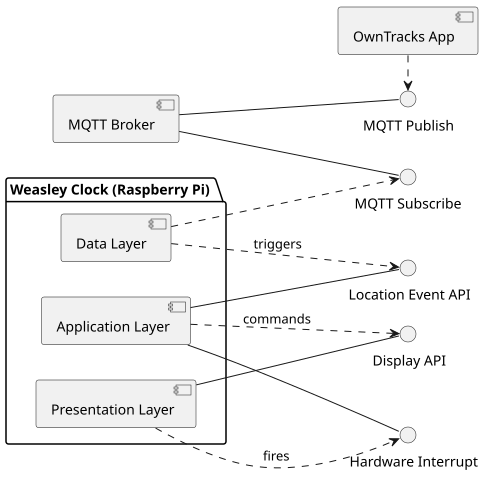
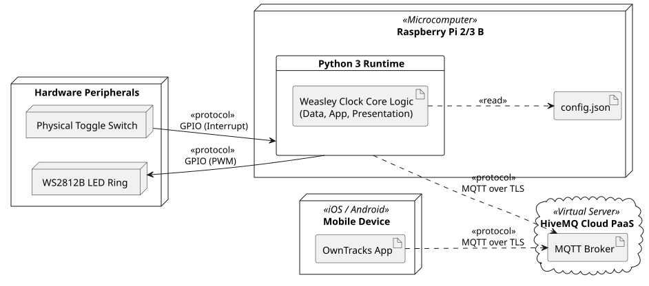

# Application Overview and Objectives

## Table of Contents

1. [Application Overview and Objectives](#application-overview-and-objectives)
2. [Use Cases](#use-cases)
3. [Architecture](#architecture)

## Application Overview

The purpose of this system is to provide a means to know the location of important people in the users' household
without needing to resort to invasive measures like sending "where are you" text messages. It does so by showing the
location of up to four people on a NeoPixel (RGB LED) ring that is controlled by a Raspberry Pi, taking inspiration from
the "Weasley Clock" as seen in *Harry Potter*.

Each person whose location is to be represented on the clock has to install a GPS tracking app on their phone. This app
pushes the current GPS coordinates to a MQTT broker which relays the data to the Raspberry Pi. The latter needs to map
the received coordinates to a semantic position and control the NeoPixel ring to show this update.

The main target audience of my project are people who often worry about the whereabouts of loved ones like parents, for
example. They tend to seek reassurance by excessively relying on workarounds, such as checking the 'last online' status
on messenger apps. My project seeks to provide an alternative solution to this problem by having a piece of ambient
technology installed in their home that passively provides the users with the information they need.

## Objectives

#### Functional Requirements

1. **Geofencing**: The system must convert raw incoming GPS coordinates (latitude/longitude) into predefined semantic
   locations.
2. **Location Display**: The system must display the semantic locations (e.g. "At Home", "At Work", ...) of four people
   at the same time.
3. **Privacy Mode**: The system must allow users to immediately stop all location visualizations via a physical toggle
   switch.
4. **Error State**: The system must visually indicate when it has encountered a critical error such as permanent WiFi
   connection loss.
5. **Fallback State**: If the system receives a valid GPS coordinate that does not map onto any known semantic state, it
   must display a "Unknown" state for the household member.
6. **Configuration**: The system must allow an administrator to define and update the coordinates/geofences of the
   semantic locations via a configuration file.
7. **System Initialization**: The system must automatically start the core application logic upon device power-up,
   without requiring user intervention.

#### Non-Functional Requirements

1. **Architectural Constraint**: The physical device must operate securely behind a standard home router NAT without
   port forwarding. Therefore, the system must use a distributed architecture with a cloud-hosted message broker.
2. **Design Constraint**: The physical device must use addressable LED rings to visualize the current state, satisfying
   the ambient design philosphy.
3. **Hardware Platform Constraint**: The core application logic and hardware control must be executed on a Raspberry Pi
   microcomputer.
4. **Calm Technology**: The physical interface must be entirely ambient and require zero active digital interaction (
   e.g. no touchscreens) to read the current state.
5. **Usability**: The physical interface must display the semantic locations in a way that is obvious even to people
   with little IT knowledge.
6. **Data Freshness**: The Weasley Clock must consider location data "stale" if no update has been received within 20
   minutes and visually reflect that the user's data is outdated/unknown.
7. **Security**: All data transmission between the message broker and physical device needs to be encrypted to prevent
   unauthorized access to location data.

# Use Cases

## Roles and Actors

- **Household Member (Human)**: The primary user of the Weasley Clock. They passively view the other members' locations
  and toggle the privacy mode.
- **The mobile OwnTracks App (External System)**: This app is installed on every household member's phone and publishes
  the current location to an MQTT broker in frequent intervals.
- **System Administrator (Human)**: Configures the geofences used for mapping the combination of coordinate and person
  to a semantic position (e.g. "at work"). They are also a household member.

## Use Case Diagram



## Textual Use Case Descriptions

| Category              | Entry                                                                                                                                                                                                                                                                                                                                                                                                                                                           |
|-----------------------|-----------------------------------------------------------------------------------------------------------------------------------------------------------------------------------------------------------------------------------------------------------------------------------------------------------------------------------------------------------------------------------------------------------------------------------------------------------------|
| Use Case ID           | UC-01                                                                                                                                                                                                                                                                                                                                                                                                                                                           |
| Title                 | Update Location Data                                                                                                                                                                                                                                                                                                                                                                                                                                            |
| Scope                 | Data Ingestion / Application Logic                                                                                                                                                                                                                                                                                                                                                                                                                              |
| Short Description     | The system ingests GPS coordinates, computes their semantic meaning (e.g. "At Home" or "At Work") and updates the physical display accordingly.                                                                                                                                                                                                                                                                                                                 |
| Precondition          | The Weasley Clock is powered on, connected to the MQTT broker and the main application loop is running.                                                                                                                                                                                                                                                                                                                                                         |
| Actors                | OwnTracks App, Household Member (Passive Observer)                                                                                                                                                                                                                                                                                                                                                                                                              |
| Trigger               | The OwnTracks App publishes a new location to the MQTT broker.                                                                                                                                                                                                                                                                                                                                                                                                  |
| Main Success Scenario | 1. The system receives a new location/GPS coordinates from the OwnTracks App.<br>2. The application logic compares the received coordinates against the pre-configured geofences. <br>3. For each person-coordinate pair, a semantic location is computed (e.g. "At Work").<br>4. The presentation layer visualizes this location on the LED ring by illuminating the corresponding segment.<br>5. A Household Member passively observes the current locations. |
| Success Guarantees    | The locations displayed on the Weasley Clock reflect the the current locations as provided by the external tracker.                                                                                                                                                                                                                                                                                                                                             |
| Exceptions            | <br>1. **Unknown Locations (Fallback State)**: If the current location of a household member does not fall into any known geofence, it is displayed as "unknown" on the Weasley clock. <br> 2. **Privacy Mode Active**: No positions are visualized while in Privacy mode, see UC-04.                                                                                                                                                                           |
| Issues/Comments       | The geofencing logic relies on an internal configuration file, see also UC-05.                                                                                                                                                                                                                                                                                                                                                                                  |

| Category              | Entry                                                                                                                                                                                                                                                        |
|-----------------------|--------------------------------------------------------------------------------------------------------------------------------------------------------------------------------------------------------------------------------------------------------------|
| Use Case ID           | UC-02                                                                                                                                                                                                                                                        |
| Title                 | View Ambient Location                                                                                                                                                                                                                                        |
| Scope                 | Presentation Layer / Display Mechanism                                                                                                                                                                                                                       |
| Short Description     | A Household Member views the current location of the other members on the Weasley Clock without actively interacting with it.                                                                                                                                |
| Precondition          | The Weasley Clock is powered on and physically visible to the user.                                                                                                                                                                                          |
| Actors                | Household Member                                                                                                                                                                                                                                             |
| Trigger               | A Household Member glances at the Weasley Clock.                                                                                                                                                                                                             |
| Main Success Scenario | 1. A Household Member looks at the Weasley Clock.<br>2. The current locations of the household members are shown as colour-coded illuminated LED segments on the device.<br>3. The user understands the LED patterns, allowing them to deduct the locations. |
| Success Guarantees    | The user is informed about the locations of the other household members entirely through peripheral/ambient awareness.                                                                                                                                       |
| Exceptions            | 1. **System in Error State**: Unrecoverable error states are displayed by designated LED patterns and override any other visualizations, see UC-03. <br> 2. **Privacy Mode**: No positions are visualized while in Privacy mode, see UC-04.                  |
| Issues/Comments       | Decide on an easy to understand display mechanism such as segmenting the NeoPixel ring into five equal parts, each representing a different semantic position.                                                                                               |

| Category              | Entry                                                                                                                                                                                                                                                                                                                                                              |
|-----------------------|--------------------------------------------------------------------------------------------------------------------------------------------------------------------------------------------------------------------------------------------------------------------------------------------------------------------------------------------------------------------|
| Use Case ID           | UC-03                                                                                                                                                                                                                                                                                                                                                              |
| Title                 | View System Error Status                                                                                                                                                                                                                                                                                                                                           |
| Scope                 | System Resilience / Error Handling                                                                                                                                                                                                                                                                                                                                 |
| Short Description     | Users are informed about errors the system cannot recover from by itself (e.g. persistent loss of connection). This happens via designated LED patterns, prompting human intervention.                                                                                                                                                                             |
| Precondition          | The Weasley Clock is powered on, the main loop of the application is running.                                                                                                                                                                                                                                                                                      |
| Actors                | Household Member                                                                                                                                                                                                                                                                                                                                                   |
| Trigger               | The system detects an error from which it cannot recover by itself.                                                                                                                                                                                                                                                                                                |
| Main Success Scenario | 1. An error caused by external factors is detected (e.g. MQTT broker unreachable for > 100 seconds)<br>2. The system transitions into a "fatal error" state.<br>3. The system overrides any visualizations with a designated error pattern (e.g. all LEDs pulsing red).<br>4. A Household Member notices this pattern and knows that the system needs maintenance. |
| Success Guarantees    | The system informs users about its error state and stops them from relying on incorrect/stale location data.                                                                                                                                                                                                                                                       |
| Exceptions            | 1. **Displaying Errors while in Privacy Mode**: The system must display errors even when Privacy Mode is active, see UC-04                                                                                                                                                                                                                                         |
| Issues/Comments       | Transient errors such as losing WiFi connectivity for 10 seconds should not automatically result in a "critical error state". Instead, the system should try to silently recover.                                                                                                                                                                                  |

| Category              | Entry                                                                                                                                                                                                                                                                                                                 |
|-----------------------|-----------------------------------------------------------------------------------------------------------------------------------------------------------------------------------------------------------------------------------------------------------------------------------------------------------------------|
| Use Case ID           | UC-04                                                                                                                                                                                                                                                                                                                 |
| Title                 | Toggle Privacy Mode                                                                                                                                                                                                                                                                                                   |
| Scope                 | Presentation Layer / Hardware Interface                                                                                                                                                                                                                                                                               |
| Short Description     | Allows a user to have the display enter a "privacy mode" via a physical toggle. The system continues to ingest data, but turns all visualizations off.                                                                                                                                                                |
| Precondition          | The Weasley Clock is powered on, the main loop of the application must be running and the system must be listening for hardware interrupts caused by GPIO pins.                                                                                                                                                       |
| Actors                | Household Member                                                                                                                                                                                                                                                                                                      |
| Trigger               | A household member flips the privacy switch of the device.                                                                                                                                                                                                                                                            |
| Main Success Scenario | 1. A Household member flips the privacy switch to the "ACTIVE" position.<br>2. The system detects a corresponding GPIO state change.<br>3. The system reacts to this event by deactivating the LED location indicators.<br>4. The system no longer displays the locations, but still processes incoming MQTT updates. |
| Success Guarantees    | The Weasley Clock no longer displays locations. The system updates its state to "Privacy Mode Active", suppressing any updates to the LED Ring caused by location updates.                                                                                                                                            |
| Exceptions            | 1. **State Conflict**: In the case of an active error state (e.g. No Connection, causing the LEDs to flash red), the system recognizes the flipped switch, but does not switch off the LEDs so the user knows that the device is currently not working.                                                               |
| Issues/Comments       |                                                                                                                                                                                                                                                                                                                       |

| Category              | Entry                                                                                                                                                                                                                                                                                                                                                                                                                                             |
|-----------------------|---------------------------------------------------------------------------------------------------------------------------------------------------------------------------------------------------------------------------------------------------------------------------------------------------------------------------------------------------------------------------------------------------------------------------------------------------|
| Use Case ID           | UC-05                                                                                                                                                                                                                                                                                                                                                                                                                                             |
| Title                 | Configure System Parameters                                                                                                                                                                                                                                                                                                                                                                                                                       |
| Scope                 | System Administration / Configuration                                                                                                                                                                                                                                                                                                                                                                                                             |
| Short Description     | A System Administrator sets up the geofences and user mappings by editing a configuration file on the device.                                                                                                                                                                                                                                                                                                                                     |
| Precondition          | The Weasley Clock is powered on, is connected to the local network and the Administrator has valid SSH credentials to access the host system.                                                                                                                                                                                                                                                                                                     |
| Actors                | System Administrator                                                                                                                                                                                                                                                                                                                                                                                                                              |
| Trigger               | The System Administrator wants to set up the device for the first time or change existing geofences.                                                                                                                                                                                                                                                                                                                                              |
| Main Success Scenario | 1. The System Administrator accesses the filesystem of the device and opens the configuration file.<br>2. The Administrator changes the semantic locations by entering new latitude/longitude/radius triplets.<br> 3. The Admin saves the file and restarts the core application.<br>4. The System parses and validates the configuration file on startup.<br>5. The system now uses the updated geofences.                                       |
| Success Guarantees    | The system now uses the geofences the administrator configured.                                                                                                                                                                                                                                                                                                                                                                                   |
| Exceptions            | 1. **Semantic Validation Error**: If the entered geofences are not logically valid (e.g. overlapping geofences), the system shows this via a "fatal error" state, see UC-03. <br>2. **Syntax Errors**: If the syntax of the configuration file is invalid, the system also enters a "fatal error" state, see UC-03.<br> 3. **Missing Configuration File**: If the configuration file is not found, the system signals this analogous to 1. and 2. |
| Issues/Comments       | Consider the implementation of a web interface that allows for easier configuration and prevents syntax errors.                                                                                                                                                                                                                                                                                                                                   |

# Architecture

## Overview



The component diagram above depicts the core components of my project: The OwnTracks App, installed on every Household
Member's smartphone, continuously publishes GPS data to the MQTT broker.

The Raspberry Pi houses the central application logic, including a Data Layer which subscribes to updates from the MQTT
broker. It triggers the Application Layer's Event API (by executing a callback function). The Application Layer manages
the application state and converts received coordinates into semantic positions. Those positions are passed on to the
Presentation Layer via its Display API. The Presentation Layer visualizes the semantic positions by controlling an RGB
LED ring. It also monitors if the Privacy Switch was toggled and prompts the Application Layer to act upon it.

## Architecture for Component 1: Cloud MQTT Broker

The system uses a cloud-hosted MQTT broker to decouple mobile location publishers from the Raspberry Pi subscriber. This
design supports multiple smartphones concurrently and improves resilience under unstable network conditions.

A broker is required because the Raspberry Pi runs behind a home NAT router without port forwarding. As a result,
external clients cannot reliably initiate direct inbound connections to the device.

### Details

- **Broker Choice**: HiveMQ Cloud provides a managed MQTT service with minimal setup effort and built-in TLS support.
  Its free tier (10 GB/month) is sufficient for development and testing workloads.

- **Retained Messages for Fast State Recovery**: Mobile clients publish retained location messages. After reconnecting,
  the Raspberry Pi immediately receives the latest known state for each user instead of waiting for the next live
  update.

## Architecture for Component 2: Weasley Clock Core (Raspberry Pi)

The Architecture of the core application logic is structured as follows:

### 2.1: Data Ingestion Layer

- **Responsibilities**: Connect to the MQTT broker and subscribe to the relevant wildcard topics (e.g.
  `owntracks/household/+`); filter out malformed data and pass coordinate updates on to application layer's location
  event API
- **Offered Interfaces**: None
- **Required Interfaces**: The MQTT broker's subscribe API and the application layer's location event API
- **Libraries**: `paho-mqtt`, `json`

### 2.2: Application Layer

- **Responsibilities**: Control the application state and react to location updates / a flipped privacy switch; convert
  GPS coordinates into semantic locations; trigger visualizations in the presentation layer; read and validate the
  configuration file
- **Offered interfaces**: A **Location Event API** (for acting upon a coordinate update) and a **Hardware Interrupt API
  ** (for acting upon toggling the physical switch). This happens in the form of callback functions that are offered to
  the other layers.
- **Required Interfaces**: The presentation layer's visualization API
- **Libraries**: `geopy` for calculating the geofences, `time` for deciding when a location has become "stale"

### 2.3: Presentation Layer

- **Responsibilities**: Control the NeoPixel LEDs and translate semantic positions into specific NeoPixel LED colours
  and patterns. Listen to GPIO interrupts and inform the application layer of the current privacy switch state.
- **Offered interfaces**: A **Visualization API** for displaying semantic positions, fallback states and system error
  states
- **Required interfaces**: Hardware Interrupt API of the application layer
- **Libraries**: `rpi_ws281x`, `adafruit-circuitpython-neopixel`, `gpiozero`

## Architecture for Component 3: OwnTracks App (External Data Provider)

The OwnTracks App is a Off-The-Shelf solution for publishing GPS data to a MQTT broker. It comes with a pre-defined
payload that follows the structure

``` json
{
  "_type": "location",
  "lat": 47.2082,
  "lon": 17.3738,
  "tst": 1679659200,
  "acc": 15,
  "batt": 85
}
```

which provides the necessary data for the core application logic. The app's task is to wake up in regular intervals (
e.g. every 10 minutes), acquire the current location from the phone's OS and send it to the MQTT broker.

## Technology Stack

### Software Stack

- **Main Programming Language**: Python 3 (running on the Raspberry Pi)
- **Main Libraries**: `paho-mqtt` (for subscribing to MQTT topics), `geopy` for geofencing, `rpi_ws281x` for controlling
  NeoPixel LEDs
- **GPS Tracking App**: OwnTracks
- **MQTT Broker**: HiveMQ Cloud

### Hardware Stack

- Raspberry Pi 2/3 B
- NeoPixel RGB LED Ring (60 LEDs) including a 5V power supply and a 3.3V to 5V voltage converter
- Physical Toggle Switch (for activating Privacy Mode)
- A 3D-printed enclosure and standard prototyping wiring (jumper wires/perfboard)

## Deployment Diagram



## User Interface

The User Interface consists of a physical semantic layer (e.g., a printed or engraved faceplate detailing the
locations), the underlying NeoPixel LED ring, and the hardware Privacy Switch. While the Privacy Switch is a
self-explanatory binary input (Privacy Mode On/Off), the location data is visualized purely through ambient LED
patterns.

A simple, highly legible visualization pattern would be the following:

- **Segmented Layout**: The LED ring is divided into 5 equal spatial segments, each physically labeled to represent one
  of the 5 semantic locations. Assuming a standard 60-LED ring, each location is represented by an arc of 12 LEDs.
- **Empty State**: If no household members are currently at a specific location, the corresponding 12 LEDs remain unlit
  to minimize visual clutter.
- **User Color Mapping**: Each tracked household member is assigned a distinct color.
- **Single Occupancy**: If exactly one household member is at a specific location, all 12 LEDs in that segment
  illuminate continuously in that member's designated color.
- **Multiple Occupancy (Shared Locations)**: If multiple members share a location, the 12 LEDs are divided into
  contiguous, equal-sized blocks of color (e.g., two members result in a block of 6 LEDs in Color A, and 6 LEDs in Color
  B). This split scales proportionally for three or four members.
- **System Error Override**: Unrecoverable system errors override all standard location visualizations. The entire ring
  displays a uniform, distinct pattern (e.g., all 60 LEDs pulsing red) to signal the need for maintenance.

# User Study

The device will be deployed in a home for the duration of one week to capture the users' experience of using the Weasley
Clock vs. relying on "traditional" measures such as checking their phone. The primary goal will be to explore effects on
Information Anxiety and perceived connectedness. This will be achieved via semi-structured interviews at the end of the
testing period. The resulting qualitative data will be evaluated using thematic analysis to identify shifts in user
habits and emotional responses.
