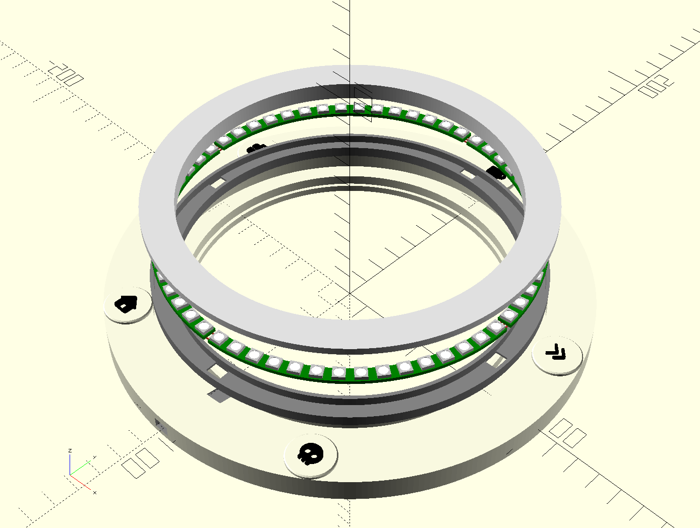

# The Weasley Clock Casing

The files for 3D-printing the case are [LED_clock_ring1.5.scad](LED_clock_ring1.5.scad) and [location_badges.scad](location_badges.scad). These files can be opened and edited with [OpenSCAD](https://openscad.org/).
The location badges are in a separate file purely because it makes exporting them as a separate `stl` easier.
I first printed the clock face, then glued the location badges onto it, using the `stencil.pdf` to mark the concrete locations on the clock.

You could also print everything at once, I simply started with the clock face as a test print (to measure dimensions and assess fit), then decided to keep the part as-is, but add location icons on top.
Gluing the icons on helped me recycle the printed parts instead of throwing them away.

The electronics box is generated with [boxes.py](https://boxes.hackerspace-bamberg.de/), a parametric online box generator, and then cut out of 4mm thick plywood.
As an alternative, a 3D-printed or cardboard box would work as well.
