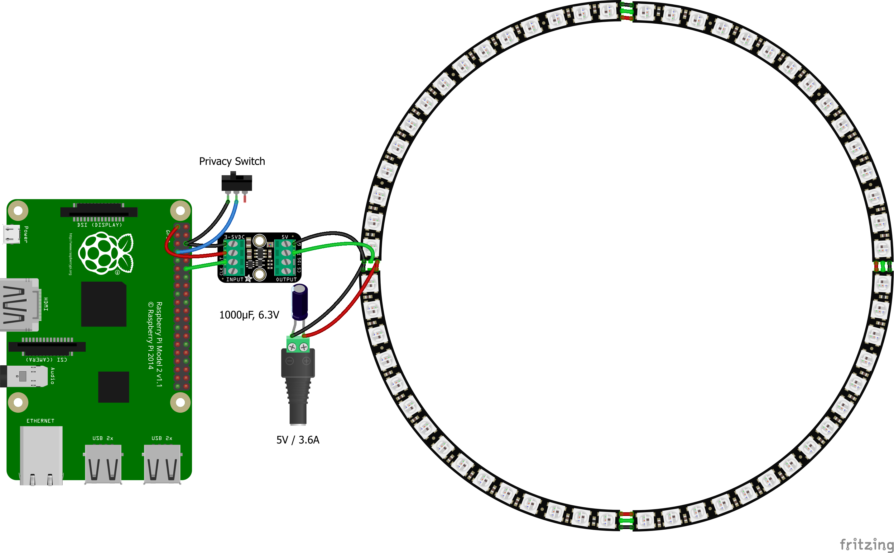

# Hardware Configuration

The Hardware Components used are:

- 1x Raspberry Pi 2 (other generations should work as well)
- 1x SPST Switch
- 1x Adafruit Pixel Shifter
- 4x NeoPixel 1/4 60 Ring, soldered together
- 1x 5V / 3.6A minimum power supply (for the LED ring)
- 1x 5V Micro-USB power supply (for the Raspberry Pi)
- 1x 2.1mm jack to screw terminal block adapter
- 1x 1000µF / 6.3V capacitor

See the [Adafruit Pixel Shifter Guide](https://learn.adafruit.com/adafruit-pixel-shifter/circuitpython-and-python#python-computer-wiring-3187297) and [NeoPixel Guide](https://learn.adafruit.com/adafruit-neopixel-uberguide/powering-neopixels) for further details.
